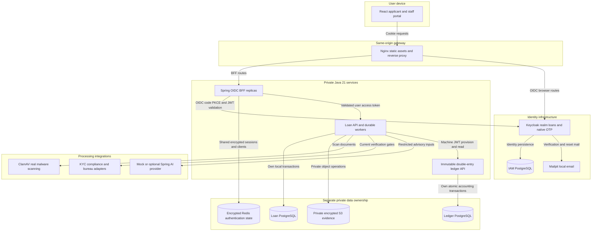

# Architecture Diagram

Source snapshot: 2026-10-30. Placeholder Bank combines an applicant/staff portal, an OIDC BFF, independent loan origination and ledger services, and privately networked dependencies. This describes the implementation and default local IAM stack, including explicit synthetic-provider limitations.

The primary deliverable is the editable [draw.io architecture diagram](../../../../../docs/placeholder-bank-architecture.drawio). Open it in diagrams.net or a draw.io editor. Its ten pages use native editable shapes and connectors, source tooltips, and clickable page tabs:

| Page | Content |
|---|---|
| 01 | System architecture, service ownership and trust boundaries |
| 02 | Frontend components, BFF, OIDC/PKCE, sessions, CSRF and authorization |
| 03 | Loan controllers, services, worker lanes, adapters and persistence |
| 04 | Upload, quarantine, scanning, extraction, assessment and restricted AI |
| 05 | Application states, independent human review and atomic approval |
| 06 | Account provisioning, stable-reference recovery and actual balance reads |
| 07 | Ledger components, locking, posting, reversals and commit checks |
| 08 | Origination tables, foreign keys, logical references and retention |
| 09 | Ledger tables, exact money, uniqueness and database safeguards |
| 10 | Compose readiness, build outputs, development and verification |

Blue shapes represent application components, teal represents web components, purple represents IAM, green represents data, and amber represents jobs/adapters. Each page names its sources and explains its arrow semantics. Solid lines in the data-model pages represent declared foreign-key relationships; dashed lines represent logical references.

## Application Architecture

<!-- mermaid-checked: no \n, no em-dash/en-dash, no {} in labels, subgraphs are id["label"], arrows are -->|"label"|, all subgraphs closed by end, ids unique -->

### Technology Stack Summary

| Layer | Technology | Version | Purpose |
|---|---|---|---|
| Shared JVM build | Java / Spring Boot / root Maven Wrapper | 21 / 3.5.16 / repository wrapper | Parent-managed dependencies and three independently packaged services |
| Frontend | React / TypeScript / Vite | 19.3.1 / 6.0.3 / 8.3.5 | Strict applicant and staff SPA |
| Frontend state/forms | TanStack Query / React Hook Form / Zod / Material UI | 5.105.0 / 7.91.0 / 4.6.7 / 9.5.0 | Identity-aware queries, validation and UI |
| Gateway | Nginx | 1.28.0 | Same-origin static assets, BFF and identity proxy |
| Browser identity | Spring Security OAuth2 Client and Resource Server | Spring Boot managed | Confidential authorization-code PKCE and validated token relay |
| IAM | Keycloak | 26.4.7 | Trusted tenant/role claims, native staff OTP, OIDC sessions |
| Authentication state | Redis / Spring Session | 7.4.5 / Spring Boot managed | AES-GCM shared sessions, authorized clients, refresh locks and revocation |
| Persistence | PostgreSQL / JPA / JDBC / Flyway | 17.10 / Spring Boot managed | Separate loan, ledger and IAM databases; migrations and constraints |
| Evidence storage | SeaweedFS S3 / AWS SDK | 3.85 / 2.31.78 | Private encrypted objects and metadata checks |
| Document security | ClamAV / PDFBox | 1.4.3 / 3.0.5 | Real scan, bounded text extraction and replaceable OCR interface |
| Advisory | Spring AI / Resilience4j | 1.1.2 / 2.3.0 | Restricted OpenAI/Ollama adapters, rate limits and circuit breaker |
| Local email | Mailpit | 1.29.2 | Registration verification and password-reset messages |
| Image/frontend build | Node | 24.22.1 in Docker; host minimum 24 | Locked npm build and optional private Vite overlay |
| Verification | Surefire/Failsafe / Testcontainers | 3.5.4 / 1.21.4 | Unit, PostgreSQL, Redis, storage and real-ledger integration tests |
| Browser/component verification | Playwright / Vitest | 1.64.1 / 5.0.5 | Real-Keycloak journeys and frontend tests |

### Data Storage & External Services

The loan service owns the `loans` database and `origination` schema. Drafts, submitted payloads, assessment and decision payloads, evidence and review explanations use application encryption. Immutable approved terms include exact principal/rate values and an indicative schedule; the schedule is stored as JSON text. The loan database stores account references but no outstanding balance. The ledger service owns its separate `ledger` database/schema and derives balances from exact journal entries. No JPA entities, repositories, database credentials or database access are shared between the services.

Redis stores authentication state only. Private evidence objects use generated UUID keys and AES-GCM encryption in S3-compatible SeaweedFS. Downloads require a completed upload and a real CLEAN scan. Keycloak has its own PostgreSQL store and uses Mailpit for local email. There is no separate message broker: PostgreSQL durable jobs provide the work queue.

The default local financial verification adapters are explicitly synthetic. Without the enabled synthetic configuration or a supplied provider, results remain unavailable. AI defaults to a deterministic mock; optional OpenAI/Ollama providers receive approved financial inputs and validated source references with no database, decision, ledger or payment tools. The default OCR adapter is unavailable/unreliable and requires review where extraction cannot be completed.

### Key Architectural Decisions

- The browser uses one same-origin BFF client. OAuth tokens remain server-side; both BFF replicas share encrypted authentication state, bounded refresh coordination and revocation in Redis. Loan-service independently enforces tenant/ownership, staff assurance and business gates.
- Submission commits a frozen revision and durable job atomically. Approval commits an append-only human decision, unique loan, immutable terms, audit and provisioning job atomically. External work runs outside local database locks; leases, fences and current-revision checks protect result commits.
- The ledger owns accounting correctness. Sorted PostgreSQL account locks precede a separate aggregate read; idempotency, header, all entries and finalisation share one transaction with deferred commit checks. Provisioning creates a protected ASSET/DEBIT principal account with zero balance and no journal. The loan remains awaiting agreement and unfunded.

## Component Relationships

```mermaid
flowchart LR
    subgraph cPresentation["Presentation"]
        cPortal["React routes forms and query cache"]
        cBff["BFF controller route policy and proxy"]
        cLoanControllers["Loan controllers and immutable DTOs"]
        cLedgerControllers["Ledger controllers and immutable DTOs"]
    end
    subgraph cBusiness["Business logic"]
        cApplication["Application and document services"]
        cDecision["Decision and compliance services"]
        cLoan["Loan and operations services"]
        cJournal["JournalService and TransactionExecutor"]
        cPosting["PostingRules and account services"]
    end
    subgraph cWorkflow["Workflow and calculations"]
        cJobs["JobQueue and worker scheduler"]
        cWorker["OriginationWorker and retention"]
        cMath["Affordability and annuity calculator"]
        cAdapters["Document verification AI and ledger adapters"]
    end
    subgraph cPersistence["Data access"]
        cLoanRepos["Loan JPA repositories and focused JDBC"]
        cLedgerRepos["Ledger locks aggregates writer and JPA"]
    end
    subgraph cCrossCutting["Security and infrastructure"]
        cAuth["OIDC sessions token relay and CSRF"]
        cAccess["Actor ResourceAccess and staff assurance"]
        cAudit["Idempotency encryption and minimal audit"]
        cGuards["Flyway privileges and database guards"]
    end
    cPortal -->|"Same-origin client"| cBff
    cAuth -.->|"Authenticates and protects"| cBff
    cBff -->|"Allowlisted user-token HTTP"| cLoanControllers
    cAccess -.->|"Authorizes nested resources"| cLoanControllers
    cLoanControllers -->|"Delegates"| cApplication
    cLoanControllers -->|"Explicit review"| cDecision
    cLoanControllers -->|"Reads and operations"| cLoan
    cApplication -->|"Local persistence"| cLoanRepos
    cDecision -->|"Local persistence"| cLoanRepos
    cLoan -->|"Local persistence"| cLoanRepos
    cApplication -->|"Atomic submission enqueue"| cJobs
    cDecision -->|"Atomic provisioning enqueue"| cJobs
    cJobs -->|"Lease and fence"| cWorker
    cWorker -->|"Snapshots and fenced commits"| cLoanRepos
    cWorker -->|"Deterministic calculations"| cMath
    cWorker -->|"External work outside locks"| cAdapters
    cLoan -->|"Actual balance lookup"| cAdapters
    cAudit -.->|"Claims and audit"| cApplication
    cAudit -.->|"Claims and audit"| cDecision
    cAdapters -->|"Restricted provision and read HTTP"| cLedgerControllers
    cLedgerControllers -->|"Post and reverse"| cJournal
    cLedgerControllers -->|"Accounts and reports"| cPosting
    cJournal -->|"Lock and validate"| cPosting
    cJournal -->|"Claim and write atomically"| cLedgerRepos
    cPosting -->|"Ordered locks then fresh aggregates"| cLedgerRepos
    cGuards -.->|"Commit constraints and privileges"| cLedgerRepos
```

<!-- mermaid-checked: no \n, no em-dash/en-dash, no {} in labels, subgraphs are id["label"], arrows are -->|"label"|, all subgraphs closed by end, ids unique -->

### Component Inventory

| Component | Layer | Type | Responsibility |
|---|---|---|---|
| App, AuthProvider, RequireSession | Presentation | React components | Routes, capability navigation and sensitive-cache invalidation |
| Applicant and staff features | Presentation | React feature packages | Drafts, evidence, queues, review, loans and scoped operations |
| API client and bounded polling | Presentation | TypeScript utilities | CSRF, intent keys, expected version, cancellation and visibility-aware polling |
| BffController, RoutePolicy, BackendProxy | Presentation | Spring controller/services | Allowlisted bounded streaming HTTP relay |
| OIDC configuration, TokenRelay, shared stores | Security | Spring Security and Redis components | Code/PKCE, current token validation, distributed refresh and revocation |
| Actor and ResourceAccess | Security | Authorization components | JWT-derived tenant/ownership, independent reviewer and version checks |
| Loan controller package | Presentation | Spring MVC controllers | Thin application, document, verification, loan, staff and operations contracts |
| ApplicationService | Business | Transactional service | Encrypted drafts, revision freezing, submission and scoped projections |
| DocumentService, ManualExtractionService | Business | Services | Upload intent/recovery, clean downloads and superseding reviewer extraction |
| DecisionService, ComplianceReviewService | Business | Transactional services | Current gates, append-only review and atomic approval |
| LoanService, OperationsService, OperationalMetrics | Business | Services | Terms/mapping, remote balance reads, reconciliation, queues and legal holds |
| IdempotencyService and AuditService | Cross-cutting | Services | Scoped durable claims, fingerprints and minimal audit records |
| JobQueue, WorkerScheduler, OriginationWorker | Workflow | PostgreSQL queue and worker lanes | At-least-once jobs, admission, leases, fences and bounded retries |
| RetentionService and PURGE lane | Workflow | Opt-in scheduled process | Controlled retention and legal-hold-aware erasure |
| AffordabilityService and AnnuityCalculator | Business | Deterministic calculators | Exact arithmetic, explicit rounding, blockers and principal reconciliation |
| Document and integration packages | Infrastructure | Typed adapters | Storage, ClamAV, PDF/OCR, verification, restricted AI and ledger HTTP |
| Loan domain/repositories and JDBC | Data access | JPA repositories and SQL | Independent origination database and append-only snapshots |
| Ledger/Account/Journal controllers | Presentation | Spring MVC controllers | Directory, provisioning, posting, reversals and reports |
| Ledger/Account/Reporting services | Business | Service implementations | Accounts, zero-balance closure and authoritative read projections |
| JournalServiceImpl and TransactionExecutor | Business | Service and transaction boundary | Atomic post/reverse, replay and fresh-transaction retry through commit |
| PostingRules and value objects | Business | Accounting rules | Balanced bounded postings, active accounts and final normal balances |
| AccountLock/Balance/History/Idempotency repositories and JournalWriter | Data access | Focused JDBC | Sorted locks, separate aggregates, claims and explicit immutable journal writes |
| Flyway and PostgreSQL constraints/triggers | Infrastructure | Database enforcement | Deferred commit checks, composite FKs, uniqueness and runtime privilege restrictions |

Evidence: [root build](../../../../../pom.xml), [Compose base](../../../../../compose.yaml), [IAM overlay](../../../../../compose.iam.yaml), [loan implementation](../../../../../loan-service/src/main/java/com/example/loans), [ledger implementation](../../../../../ledger-core/src/main/java/com/example/ledger), [BFF implementation](../../../../../loan-bff/src/main/java/com/example/bff), [web source](../../../../../loan-web/src), [loan migrations](../../../../../loan-service/src/main/resources/db/migration), and [ledger migrations](../../../../../ledger-core/src/main/resources/db/migration).

Verification for this documentation change checks native XML/graph structure, page links, connector references, rendering, label fit and connector intersections. Runtime Maven, frontend and real-Keycloak suites are not executed for a documentation-only change.
