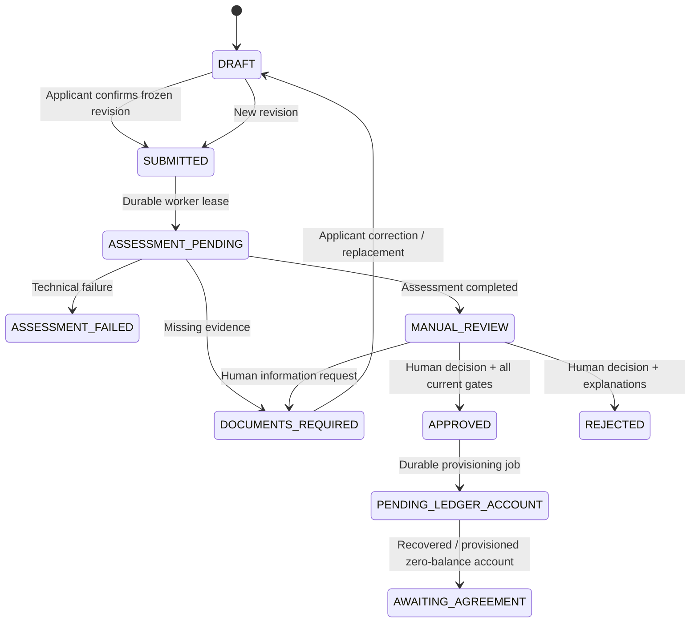

# Placeholder Bank - Staff review and human decisions

The lazy staff layout uses effective capabilities from the current validated access token. A lower-assurance session must complete Keycloak step-up. The dashboard uses real tenant-scoped counts. The queue paginates and filters on the server by state, product and UTC creation dates; search accepts an exact opaque application ID and sort is allowlisted. Assignment is not supported by the existing backend and is not simulated.

The review workspace separates applicant declarations, extracted evidence/provenance, deterministic affordability, independent verification gates and AI advisory output. Evidence is available beside the review and opens in an authenticated viewer. Every preview/download is authorized and audited. Material missing/conflicting facts and model limitations are explicit; no invented confidence percentage or credit score is displayed. A PEP/compliance concern is not a credit-risk score.

An officer may request additional information, reject or approve. The form requires reason codes, a restricted reviewer explanation and an applicant-facing explanation. Approval adds individual document/finding acknowledgements and explicit financial-fact, expense/debt and authenticity confirmations. The final dialog names the exact application revision/version, principal, term, nominal rate, product and policy. There is no bulk approval, automatic approval or accept-AI action.

The backend checks expected version, a current completed assessment, unchanged assessed policy, eligible product, fresh clean evidence, resolved deterministic concerns, current independent verification gates and meaningful acknowledgements. Self-review is rejected. Duplicate same-intent requests replay the decision; another stale intent conflicts. The UI waits for confirmed server results and never applies optimistic financial/decision updates or replays a decision automatically after reauthentication.

Compliance reviewers may record a permitted independent compliance finding only when the provider's current gate requires review. That permission does not grant a credit decision. Operations staff inspect actual job attempts, safe error codes, correlation references and next eligible times. Retrying an eligible recorded operation uses the existing loan and immutable external account reference. Configuration is read-only because there is no authorized versioned editing API.

The demo does not add assignment, general configuration editing, debt collection, agreement acceptance, disbursement or payment posting. These require explicit backend workflows, separate permission review and accounting design.
