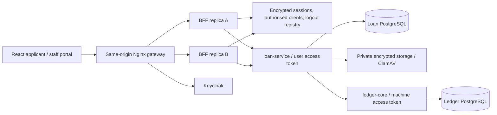

# Placeholder Bank - Web integration architecture

The Maven parent builds `ledger-core`, `loan-service` and `loan-bff` with Java 21. `loan-web` is an independently built React/TypeScript static application. It uses Vite, React Router, TanStack Query, React Hook Form, Zod and Material UI. Dependencies and the npm lockfile are pinned. Staff routes and the PDF.js viewer load separately.

The gateway serves public assets and proxies only BFF/OIDC paths. There is no browser route to either financial backend, PostgreSQL or object storage. The BFF relays validated **user access tokens**, never a privileged replacement identity, to a strict route/method allowlist. It streams bounded uploads and document responses. Loan-service owns authorization, revision checks, decisions, audit and orchestration; ledger-core owns balances and immutable journals. Redis contains authentication state only.

The public issuer is `http://localhost:18082/auth/realms/loans`. Browser authorization and callbacks use that origin. The BFF fetches discovery over the private network and checks that its issuer exactly equals the public issuer. Token, JWK and user-info requests use private endpoints with canonical issuer validation. This avoids container-loopback problems and startup cycles without weakening JWT validation.

## Additive backend contracts

- `POST /api/v1/drafts` and `PUT /api/v1/drafts/{id}` save encrypted incomplete drafts. Saves require an idempotency key; updates require `If-Match`. Full validation remains on submission.
- `GET /api/v1/products/current` supplies limits, nominal rate, questionnaire/notice versions and evidence requirements. Money/rate responses are strings.
- Application listing adds tenant-scoped server pagination, `view=mine|staff|auto`, status/product/date filters, exact UUID search and an allowlisted sort. Loan IDs are joined in one batch.
- Applicant timeline, information requests and reconsideration history expose authorized projections.
- Staff summary/configuration and operations-job pages use actual scoped database data. Configuration has no mutation API.
- `GET /api/v1/loans/{id}/balance` obtains the authorized account mapping and calls ledger-core after repository reads finish. No loan database balance is introduced.
- V4 adds nullable product queue metadata. Historical rows remain readable and appear in unfiltered queues; a product filter cannot classify old rows without metadata. V5 adds operational job correlation IDs; old jobs may have none.
- IAM identities use SHA-256 of issuer plus subject. The legacy `loan-local` identity remains unchanged. The explicit `local,iam` profile permits synthetic financial providers while requiring real Keycloak authentication.

Existing ledger transaction logic, posting rules, immutable records and backend-only demos are preserved. The IAM ledger profile restricts provisioning and reading to a separate machine client. The BFF has neither ledger credentials nor IAM administration credentials.

The maintained TypeScript DTOs are in `loan-web/src/types/api.ts`. The contract check compares paths, decimal strings and version/idempotency headers against the running loan-service OpenAPI. Component mocks are isolated tests; production routes call the real APIs.
