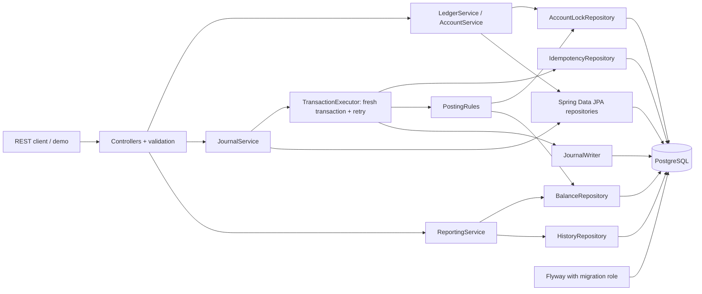
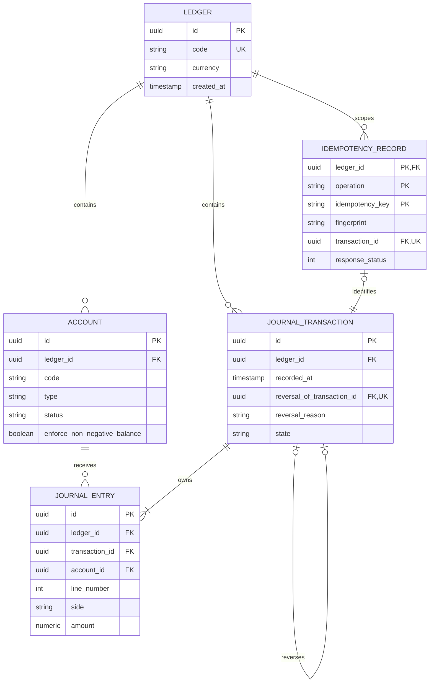

# Placeholder Bank - Architecture

The repository is a Maven reactor with a `pom`-packaged [finance-ledger-parent](../../pom.xml) and the [ledger-core application module](../pom.xml). The parent manages dependency/plugin versions and the shared wrapper. This module contains source, tests, migrations, service documentation, Docker assets, and demo scripts; its build produces `target/ledger-core-0.1.0-SNAPSHOT.jar`. Docker uses the parent directory as its build context to include both POMs.

The service uses immutable request/response records, explicit mapping, thin controllers, and separate service boundaries. Spring Data JPA manages ledger/account creation and immutable journal reads. JDBC expresses the operations where ordering, SQL aggregates, and conflict handling should be visible.

## Components



Package roles:

- controller: HTTP adaptation only.
- dto.request / dto.response: validated immutable records; entities never leave the service.
- domain.entity / domain.enums / domain.valueobject: persisted models, accounting types, Money, and balanced Posting.
- domain.repository: JPA interfaces and focused JDBC repositories.
- service / service.impl: service contracts and business workflows.
- mapper: request/domain/response conversions.
- exception / config: problem responses, correlation IDs, OpenAPI.

IdempotencyRecord is an immutable JDBC-mapped record. Journal entities are Hibernate @Immutable; they are inserted explicitly by JournalWriter. There is no generic CRUD service, cascade deletion, or mutable account balance.

## Data model



Composite foreign keys on (account_id, ledger_id) and (transaction_id, ledger_id) prevent cross-ledger entries. Account codes are unique per ledger; transaction line numbers are unique per transaction. Reversal references must remain in the same ledger. Idempotency's transaction FK is deferred to permit reserving the future UUID, but rejects a claim without a resulting journal at commit.

## Posting sequence

```mermaid
sequenceDiagram
    participant C as Client
    participant S as JournalService
    participant X as TransactionExecutor
    participant D as PostgreSQL
    C->>S: POST + Idempotency-Key
    S->>S: Validate and canonicalize money; fingerprint
    S->>X: Execute entire operation
    X->>D: BEGIN READ COMMITTED
    X->>D: INSERT idempotency ON CONFLICT DO NOTHING
    alt Existing successful key
        X->>D: New statement: read fingerprint and immutable result
        X->>X: Match or fail with 409
    else New reservation
        X->>D: SELECT affected accounts ORDER BY id FOR UPDATE
        X->>D: Separate SELECT of committed aggregates
        X->>X: Validate status and final normal balances
        X->>D: INSERT DRAFT header and all entries
        X->>D: UPDATE state to POSTED
        X->>D: Read immutable response
    end
    X->>D: COMMIT (deferred constraints)
    D-->>X: Commit succeeds
    X-->>S: Result
    S-->>C: 201 and original body / Location
```

Any failure rolls back header, entries, and reservation. Retryable SQLSTATEs restart the entire sequence on a fresh transaction after backoff. No network calls occur inside a posting transaction. The transaction completes before the controller sends its response or the success event is logged.

## Runtime and observability

The runtime role cannot migrate schema. Flyway connects using separate owner credentials, while JpaTransactionManager coordinates JPA and JDBC against the runtime DataSource. Local Docker uses a non-root application user and localhost-only published ports.

Actuator exposes only health. Logs are JSON; request correlation IDs, operation identifiers, status, duration, and retry attempts are recorded. They are diagnostic logs, not a tamper-evident or complete operational audit trail. The service intentionally has no authentication or authorisation.
